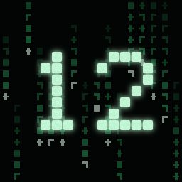
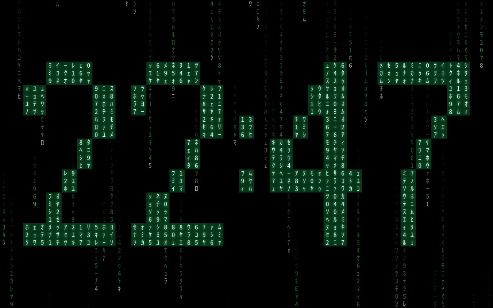
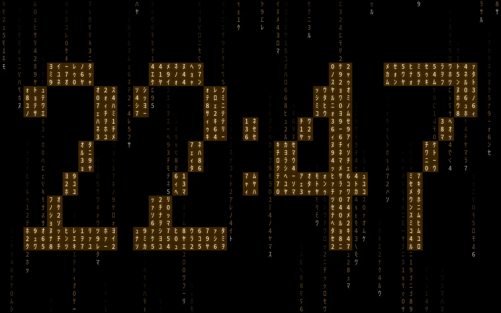
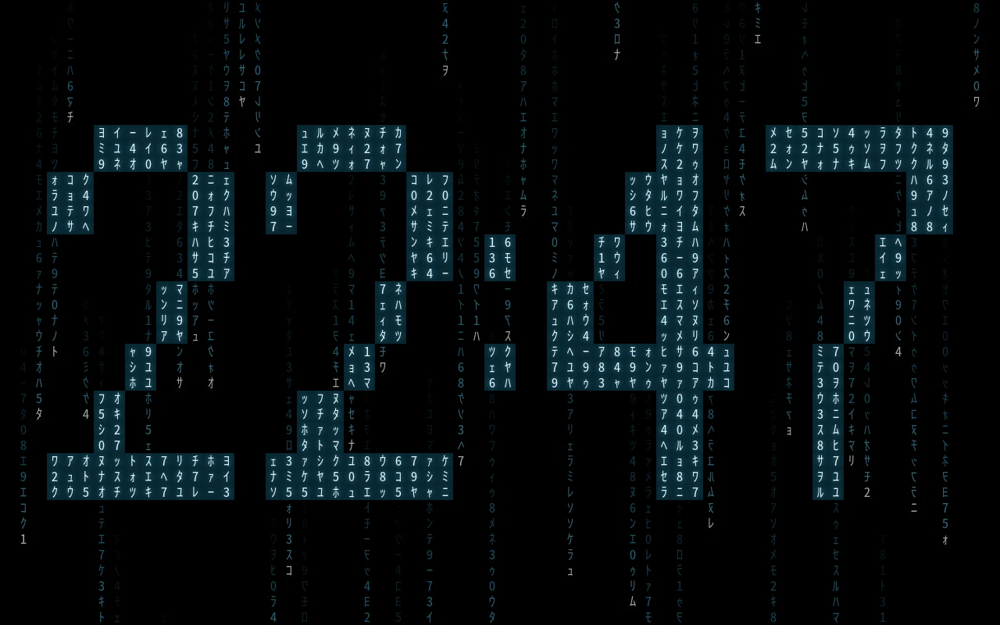
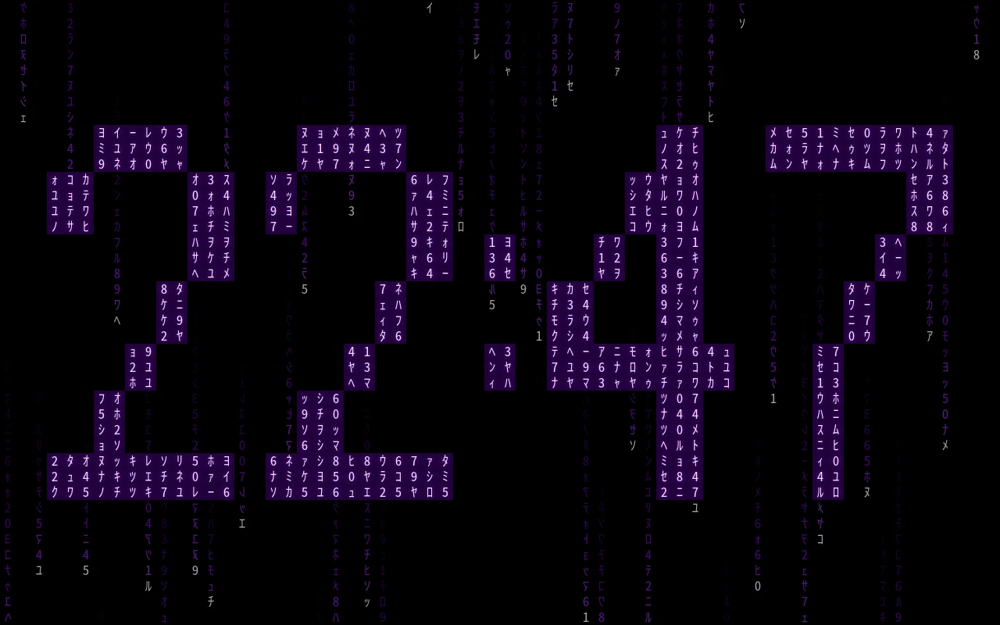
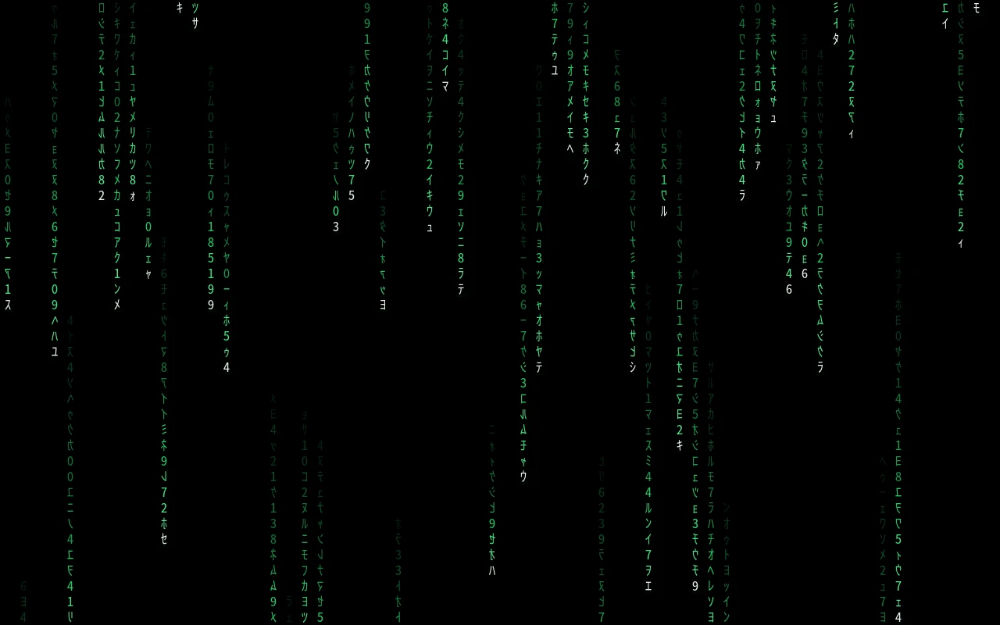
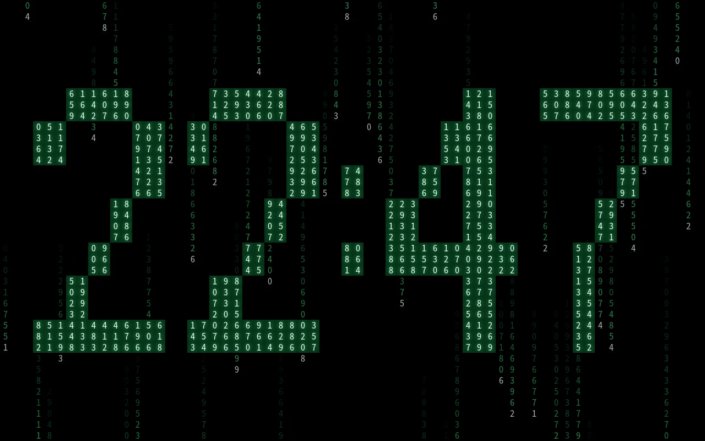
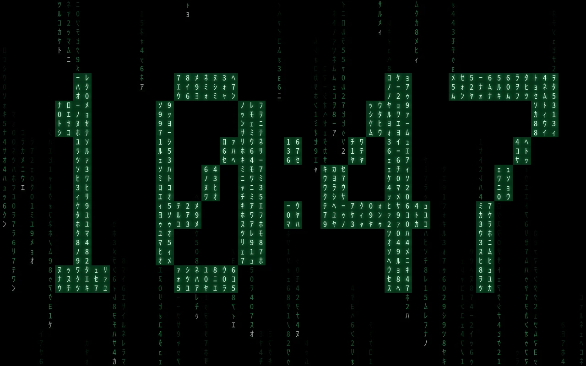
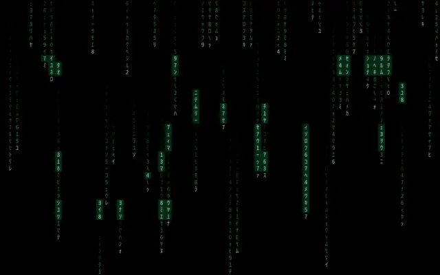
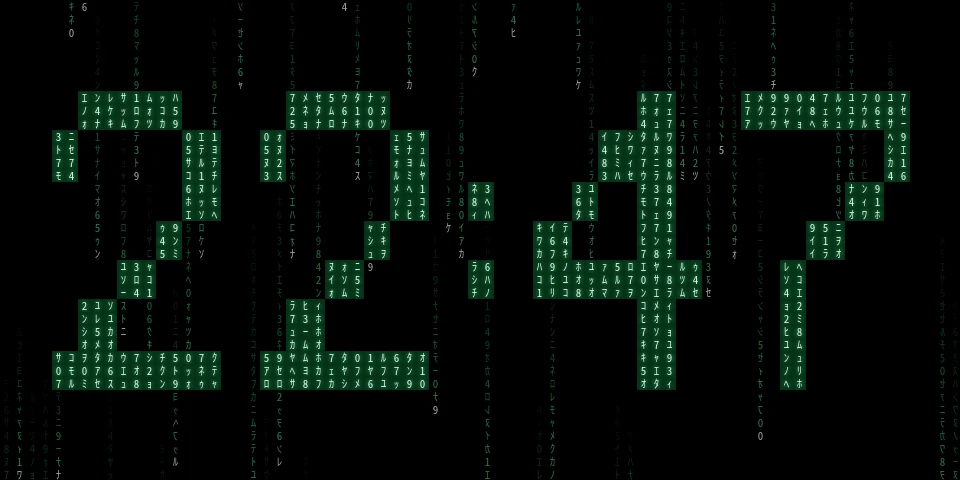

<p align="center"></p>

<p align="center"><a href="https://ko-fi.com/missingfoss"></a></p>

# Digital Rain Clock

A falling-glyph screensaver for [Kiosk Satellite](https://github.com/jxlarrea/kiosk-satellite). Columns of half-width katakana and digits rain down a black screen, and the current time forms out of the rain: a cell inside a digit lights up when a stream passes through it, so each new minute builds itself in a few seconds.


<!-- screenshots:start -->
## Screenshots

<p align="center"><br><sub>Every setting at its default</sub></p>

<table>
<tr><td width="50%" valign="top"><br><sub>Colour: Amber</sub></td><td width="50%" valign="top"><br><sub>Colour: Ice</sub></td></tr>
<tr><td width="50%" valign="top"><br><sub>Colour: Custom · Custom colour: #C77DFF</sub></td><td width="50%" valign="top"><br><sub>Time: Rain only</sub></td></tr>
<tr><td width="50%" valign="top"><br><sub>Glyphs: Digits only</sub></td><td width="50%" valign="top"><br><sub>Clock: 12-hour</sub></td></tr>
<tr><td width="50%" valign="top"><br><sub>Every setting at its default</sub></td></tr>
<tr><td colspan="2" align="center"><br><sub>960 × 480 screen · Every setting at its default</sub></td></tr>
</table>

All at 22:47, with Slow drift off; every other setting at its default. Regenerate with `python3 tools/screenshots.py`.
<!-- screenshots:end -->

## Requirements

Android 7.0 or newer, on any device where Kiosk Satellite can show a screensaver. (An Echo Dot running Kiosk Satellite has no screen, so no screensaver.) Kiosk Satellite 2026.10.23 or newer.

## Settings

Under **Plugin Manager → Digital Rain Clock**:

- **Time**: formed in the rain (the default), or rain only;
- **Colour**: green, amber, ice, or a **Custom colour** of your own. The time itself stays a pale near-white, so any colour reads;
- **Speed**: calm, normal or fast;
- **Glyphs**: katakana and digits, or digits only. A device whose fonts lack the katakana gets digits only by itself, rather than empty boxes;
- **Clock**: 24-hour, or 12-hour (no AM/PM);
- **Slow drift**: moves the time by a cell each minute, so it never sits on the same spot for long.

Choose **Digital Rain Clock** under **Screensaver → Screensaver mode**. The glyphs come from the system's fonts; nothing is shipped. The rain is drawn from glyphs prepared once, at 30 frames a second, falling to 20 or 15 by itself on a device that can't keep up, and climbing back when it can.

## Installation

### Community Plugins (Recommended)

Digital Rain Clock is listed in [Community Plugins](https://kiosksatellite.com/plugins/). Use the button below to open it in your Kiosk Satellite and install it.

[](https://kiosksatellite.com/redirect/plugin/?repository=missing-foss/digital-rain-clock)

Or search for `Digital Rain Clock` in **Settings > Plugin Manager > Browse plugins** in Kiosk Satellite.

### Manual

1. Open **Settings > Plugin Manager** in Kiosk Satellite and turn on **Enable Plugins**.
2. Choose **Add plugin**, paste `https://github.com/missing-foss/digital-rain-clock` and choose **Preview**.
3. Review the plugin and choose **Trust and install**.

### From a ZIP

For testing, build the ZIP (below) and use **Plugin Manager → Developer Tools → Install from ZIP**. Each CI run also keeps the package as its `digital-rain-clock-plugin` artifact; the downloaded file installs as it is, without unzipping.

## Data

Digital Rain Clock sends no data anywhere: it reads only its own files and makes no network request.

## Develop

You need Python 3, JDK 17 or newer, Node.js 18 or newer, and an Android SDK with a platform and build-tools (`ANDROID_HOME` set).

```sh
python3 tools/test.py                            # every test
python3 tools/build.py --android-platform 35     # dist/digital-rain-clock-<version>.zip
```

`tools/test.py` runs:

- the plugin against the SDK without a device;
- the rain's own logic (`assets/clock/rain.js`: the digits, the stencil, the lighting, the frame-rate rule, the katakana check) in Node;
- the build tools' own tests.

`tools/screenshots.py` renders the Screenshots above from `assets/clock/` at a fixed time, and rewrites their captions from the settings each shot uses. It needs Chromium (or Chrome) and ffmpeg with libwebp; run it again when the face changes.

The icon's source is `art/icon.svg`. Render it with `rsvg-convert -w 256 -h 256 art/icon.svg -o assets/icon.png`.

## Support

Digital Rain Clock is free. If you enjoy the rain and you'd like to support its development, you can on [Ko-fi](https://ko-fi.com/missingfoss).

## Licence

[Apache-2.0](LICENSE), as the plugin template and SDK it builds on.
